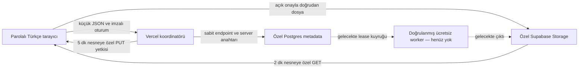

# Phase 3 — özel bulut Shorts mimarisi

Sonraki worker uygulaması ve güncel onay kapıları için [Phase 3B](PHASE3B-CLOUD-RUN.md) belgesine bakın. Aşağıdaki notlar Phase 3 teslimini anlatır.

İnceleme: 7 Kasım 2026. Bu PR **render hizmeti kurmaz, deploy yapmaz ve faturalandırma açmaz**. Gerçek bir cloud render veya yeni çıktı MP4 üretildiği iddia edilmez.

## Mimari kararı ve uygunluk

Vercel Hobby yalnızca oturum, doğrulanmış proje talimatları ve kısa metadata işlemleri içindir. Medya doğrudan özel Supabase Storage'a yüklenir. Kalıcı proje/iş/dosya kayıtları Postgres'tedir. Kodlama ileride ayrı, doğrulanmış ücretsiz CPU worker'da yapılmalıdır. Tarayıcıda FFmpeg/FFmpeg.wasm, Python, GPU veya encoding yoktur. Tarayıcı medya oynatır, talimat düzenler, seçilen dosyayı yükler ve sonucu indirir.

| Seçenek | Güncel resmi bulgu | Karar |
| --- | --- | --- |
| OCI Always Free A1 ARM | Güncel doküman 1.500 OCPU-saat / 9.000 GB-saat; toplam 2 OCPU / 12 GB RAM tarif ediyor. Eski 4 OCPU / 24 GB rakamına dayanılmadı. Home region kapasitesi garanti değil. 200 GB blok disk ortak; çıkış 10 TB/ay. | Birincil aday. Kullanıcının uygun hesabı, gerçek kapasitesi ve yalnız Always Free kaynakları doğrulanmadı. Hiçbir VM oluşturulmadı. |
| OCI hesabı | Kimlik/kart doğrulaması ve geçici banka provizyonu olabilir; kişi başına tek ücretsiz hesap. Trial bittiğinde ücretli hesaba yükseltilmemiş hesap ücretli kaynağa geçemez. PAYG'ye yükseltme bu güvenceyi değiştirir. | Yalnız doğrulanmış, yükseltilmemiş Free Tier ve Always Free etiketli kaynaklar değerlendirilmeli; ücretsiz trial kredisi uzun vadeli çözüm sayılmaz. |
| OCI süreklilik | 7 günlük düşük CPU/ağ/RAM kullanımında idle reclaim mümkün; ücretsiz SLA yok. Yapay yükle reclamation önlenmeyecek. | Kalıcı kuyruk/lease/çökme yönetimi gerekli. Süreklilik vaat edilmez. |
| ARM FFmpeg | Ubuntu 24.04 resmi ffmpeg paketi arm64 için yayımlanıyor. | CPU `libx264`/AAC adayı; seçilen imajda encoder/ffprobe doğrulaması ve cloud benchmark henüz yapılmadı. |
| Render Free | Ücretsiz background worker yok; web servisleri idle durumunda kapanır, dosyaları geçicidir. Kart varsa ek bandwidth ücretleri olabilir; yüksek dış trafik askıya alınabilir. | Kalıcı render backend'i olarak seçilmedi. |
| Google Cloud Free Tier | E2-micro kısıtlı ABD bölgelerinde ücretsiz kullanım sunar; ücretli billing hesabında kapsam dışı kullanım ücretlenir. | Sıfır beklenmedik ücret şartını tek başına sağlamaz. Trial ve bütçe alarmı hard spending lock değildir. |
| GitHub Actions | Resmi şartlar Actions'ı yazılım yaşam döngüsüyle sınırlar ve serverless uygulama parçası olarak kullanımını kısıtlar. | Kullanıcı videolarını işlemek için backend veya artifact deposu yapılmadı. |

Bu ortamda cloud hesapları/worker bulunmadığından **güvenli, render yapmayan entegrasyon** uygulanmıştır. Kamuya açık bir ücretsiz teklifin varlığı kullanıcının kapasitesinin veya billing durumunun kanıtı değildir. Oracle kaynakları, upgrade, ödeme veya yeni hesap bu PR tarafından açılmaz.

## Supabase Free ve maliyet sınırları

Resmi Free plan: 1 GB Storage, 500 MB veritabanı, 5 GB uncached ve ayrıca 5 GB cached egress; dosya üst sınırı 50 MB. İki aktif ücretsiz proje sınırı ve bir hafta hareketsizlikte pause uygulanabilir. Özel medya için cached kotayı kullanılabilir toplam gibi saymayın. Free aşımında grace/restriction olabilir; ücretli plana geçmek farklı faturalandırma koşulları getirir. Ayrı bir Free organization, yükseltme yapmama ve add-on açmama gereklidir.

Uygulama daha dar sınırlar uygular: video/ses 20 MiB, görsel 10 MiB, manifest 128 KiB; toplam 400 MiB rezervasyon, 100 nesne, günde 30 rezervasyon, 20 proje, en fazla 8 klip ve 120 saniye. JSON koordinasyon istekleri 32 KiB ile sınırlıdır. Başarısız/yarım yüklemeler alan rezervasyonunda tutulur; temizlik yapılmadan kota geri verilmez. Medya Vercel'in 4.5 MB body sınırından geçirilmez.

DB, read-link üretiminde dosya boyutunun 3 katını ayda 1 GiB issuance bütçesine yazar. Bu **provider egress hard cap değildir**: imzalı link tekrar kullanılabilir, video Range/retry istekleri ve DB trafiği ek çıkış tüketir. Kota sayacı Free plan veya faturalandırma engeli yerine geçmez. Uygulamada Supabase Management/billing/upgrade API'si veya bulut provisioning yetkisi yoktur.

Cloud storage varsayılan `false`'tur. Ayrıca SQL kontrol kaydındaki Free-plan incelemesi süresi dolduğunda bütün cloud RPC işlemleri kapanır. Bu kayıt, operatörün güncel hesap kontrolüdür; provider planını otomatik sorgulayan veya upgrade'i teknik olarak yasaklayan bir garanti değildir. Ücretli organizasyonda veya hesap durumu belirsizken etkinleştirmeyin. Yalnız incelenmiş Free hesapta manuel kurulum mümkündür; bu görevde etkinleştirilmedi/test edilmedi.

## Uygulanan iş akışı

- `/personal/shorts`: karakter, mevcut saklanmış MP4 ve sahne seçimi; yukarı/aşağı sıralama; trim, 9:16 pad/crop, mute/volume, ayrı ses başlangıcı ve dosya trim talimatları. Önizleme 360×640 veya hedef 720×1280. Kliplerin gerçek sınırları browser'da encode edilmez; sonraki cloud FFprobe doğrulaması zorunludur.
- Yerel taslaklar IndexedDB'nin mevcut `preferences` store'unda ayrı anahtarla tutulur. Şema yükseltilmez, eski karakter/sahne/iş/asset kayıtları değiştirilmez. Kaydet düğmesi zorunludur; kaydedilmemiş düzenleme için otomatik senkronizasyon vaat edilmez.
- `Proje talimatlarını buluta kaydet` sadece manifest metadata'sını kaydeder. Dosya göndermez. `Seçili dosyaları özel buluta yükle` ayrıca açık onay ister; yalnız bu projedeki video, seçili ses ve isteğe bağlı ana karakter/sahne referansları gider. Bütün arşiv taranıp otomatik paylaşılmaz. Manifest ayrıca özel JSON nesnesi olarak yüklenir.
- Kalıcı SQL kayıtları serverless instance hafızasına bağlı değildir. Her RPC ayrı istek/instance olabilir. Transaction kilidi kota rezervasyonlarını seri hale getirir; revision kontrolü eski sekmenin yeni projeyi ezmesini engeller.
- `draft`, `uploading`, `queued`, `rendering`, `completed`, `failed`, `cancelled` DB sözleşmesinde bulunur. Bu PR gerçek taslak/yükleme durumlarını ve süresi dolan onaysız yüklemeler için failed durumunu oluşturur. Süresi dolan dosya/rezervasyon korunur; tekrar deneme açık proje kaydı ve yeni yükleme onayı gerektirir. İşleri queued/rendering/completed yapan API veya callback yoktur. Completed için output asset zorunludur. Tek aktif render için DB unique index vardır.
- `Bulutta Render Al` kapalıdır; API'ye `action=render`, `enable=true`, `free=true` gönderilmesi de 409 döndürür. Ortam değişkeni veya istemci bayrağı render'ı açamaz. Hiçbir kuyruk veya sahte ilerleme oluşturulmaz.
- Durum manuel yenilemede, sekmeye dönüşte ve gerçek aktif iş varsa 15 saniyelik polling ile DB'den okunur. Okuma hatası yeni başarı durumuna çevrilmez. Gerçek worker olmadığından browser kapalıyken render devam etmesi henüz sağlanmaz.

## Güvenlik ve dosya transferi

`/api/personal/cloud` GET/POST hem middleware hem handler içinde mevcut imzalı parolalı oturumu doğrular. POST Origin/Host kontrolü ve akış üzerinden boyut sınırı uygular. Kimlik istemciden alınmaz: server `STUDIO_CLOUD_OWNER_ID` tek kişisel stüdyo sahibidir. Çok kullanıcılı kimlik modeli bu PR'ın kapsamı değildir; stüdyo parolasını bilen kullanıcı bu sahibin yetkisini paylaşır.

SQL tablolarında RLS açık; `anon`/`authenticated` rolleri için tablo veya RPC izni yoktur. Service-role anahtarı yalnız Vercel'dedir. S3 anahtarları RLS'yi bypass ettiği için sadece server'da tutulur. İstemci path/bucket/owner/endpoint belirleyemez: nesne yolu server UUID'lerinden `owner/project/asset` olarak üretilir. Supabase hostname'i sadece geçerli project-ref'ten türetilir, key başka hosta yönlendirilemez; redirects ve cache reddedilir. Ham upstream exception/response ve signed URL loglanmaz.

Native Supabase signed-upload URL'leri iki saat geçerlidir; kısa TTL şartı için S3 SigV4 kullanıldı. Server sadece belirli nesne ve PUT metodu için 300s yetki üretir; MIME, content-length ve cache-control imzaya dahil edilir. Tarayıcı sadece bu scoped URL'yi alır; secret access key, service-role ve HF token almaz. SigV4 URL içindeki public access-key identifier tek başına kimlik doğrulama sırrı değildir; linkin bütünü geçici bearer yetkisidir ve paylaşılmamalıdır. Tam linkler browser storage'a veya manifest'e yazılmaz.

Yükleme sonrası server sadece signed HEAD ile saklanan boyut/MIME bilgisini doğrular; medyayı indirmez/işlemez. Bu, codec veya dosya içeriğinin güvenli olduğunu kanıtlamaz. S3 overwrite/versioning davranışı nedeniyle worker, canlı upload yetkisi bitmeden bir input'u değişmez kabul etmemeli; ileride doğrulanan nesneyi yetki süresi sonrası özel temp alanına indirip hash/metadata doğrulaması yapmalıdır. Bu PR hiç render etmez. Read linkleri 120s geçerlidir, no-store/no-referrer ile döner. İptal edilen oturum önceden verilmiş linki süresi dolmadan iptal etmez.

S3 CORS, gerçek Free hesapta imzalı content-length doğrulaması, HEAD ve MP4 Range erişimi bu görevde **canlı test edilmedi**. SDK imzaları ve hata/ownership kapıları otomatik test edildi. Bunlar üretim dosya transferi başarısı iddiası değildir. CSP yalnız gerekli Supabase Storage hostlarına doğrudan bağlantı ekler; mevcut HF yolları korunur.

## Kurulum — yalnız kullanıcı incelemesinden sonra

Bu adımlar talimattır; kaynak oluşturma veya etkinleştirme bu görevde yapılmadı. Secret değerlerini sohbete, GitHub'a veya manifest'e yazmayın.

1. Ayrı Supabase **Free organization** ve boş proje seçin/uygunluğu kendiniz inceleyin. Paid organization, trial'a bağlı geçici teklif, ödeme gerektiren add-on, upgrade veya kart ekleme ile devam etmeyin. Organization Billing ekranını ve mevcut kullanımını doğrulayın.
2. SQL Editor'da `supabase/migrations/202611070001_private_studio.sql` dosyasını gözden geçirip manuel uygulayın. Migration var olan aynı adlı bucket'ı dönüştürmez; abort eder. Fresh dedicated proje varsayılır. Mevcut geniş Storage policies varsa uygulamayın; anon erişimini önce denetleyin. Public bucket oluşturmayın.
3. Bucket `studio-private`: private, 20 MiB object limiti, yalnız migration'daki MIME listesi. Bucket veya proje başka uygulamayla paylaşılmamalı; global kota bu varsayıma dayanır.
4. Project Storage Settings → S3 connection bölümünden region ve server-only S3 credentials alın. Bunlar AWS hesabı istemez; endpoint yalnız Supabase'dir. SDK presigning bağlantı açmaz. Normal Storage public access veya yeni public RLS policy eklemeyin.
5. Vercel Project → Settings → Environment Variables'a aşağıdaki **isimleri** server-only olarak ekleyin. Ortamı açıkça seçin; Preview'a Production anahtarlarını otomatik vermeyin. Hiçbirini `NEXT_PUBLIC_` yapmayın.
6. Ayrı rastgele UUID sahibini hem `STUDIO_CLOUD_OWNER_ID` hem SQL kontrol kaydına aynı girin. SQL Editor'da `studio_cloud_control` tablosuna `singleton=true`, bu `owner_id` ve en fazla 24 saat sonrası `storage_review_expires_at` kaydı ekleyin. Bu onay yalnız güncel Free/no-upgrade koşullarını kontrol ettikten sonra verilmeli. DB kaydı olmadan veya tarihi dolunca işlemler reddedilir. Otomatik yenileme eklenmedi.
7. Daha sonra sizin başlatacağınız deployment'ta cloud storage açılabilir. Önce tek küçük test dosyasıyla doğrulayın. 2xx upload + HEAD + private signed read + link expiry + signed body-size mismatch rejection testleri geçmezse `STUDIO_CLOUD_STORAGE_ENABLED=false` yapın. CORS'u çözmek için bucket'ı public yapmayın veya client'a anahtar vermeyin.
8. Kontrol için gerekli servislere yalnız TLS ile bağlanın. Sertifika doğrulamasını kapatmayın. Bu özellik HF auth generation kilidini veya `ENABLE_PAID_APIS=false` ayarını değiştirmez.

| Server değişkeni | Kullanım |
| --- | --- |
| `STUDIO_PASSWORD`, `STUDIO_SESSION_SECRET` | Mevcut özel oturum; aynı minimum uzunluklar korunur |
| `ENABLE_PAID_APIS=false` | Mevcut ücretli sağlayıcılar kapalı |
| `STUDIO_CLOUD_STORAGE_ENABLED=false` | Varsayılan; yalnız gözden geçirilmiş Free setup için açıkça true yapılabilir |
| `SUPABASE_PROJECT_REF` | 20 karakterli Supabase proje referansı |
| `SUPABASE_STORAGE_REGION` | S3 Settings'teki region |
| `SUPABASE_SERVICE_ROLE_KEY` | Sadece server metadata RPC yetkisi |
| `SUPABASE_S3_ACCESS_KEY_ID`, `SUPABASE_S3_SECRET_ACCESS_KEY` | Sadece server S3 presign yetkisi |
| `STUDIO_CLOUD_OWNER_ID` | Değişmez kişisel sahip UUID'si; değiştirmek eski kayıtlara erişimi keser |
| `HF_TOKEN` | Önceki fazın isteğe bağlı salt-okunur preflight'ı; Phase 3 için gerekli değil |

Vercel ayarları: Hobby, Next.js, Node 24.x, Root Directory `.`, install `node scripts/prepare-web-workspaces.mjs && npm ci --ignore-scripts --include=dev`, build `npm run build:packages && npm run build`, output varsayılan. `/personal` ve `/personal/shorts` URL rotalarıdır. Bu feature branch için Git deployment kapalıdır. Encoding Vercel'de yapılmaz; coordinator `maxDuration=30`, RPC/HEAD istekleri 6s sınır kullanır. Yükleme HTTP body olarak Vercel'e gönderilmez.

## Worker sözleşmesi ve sonraki zorunlu işler

`worker/render-contract.mjs` **çalıştırılabilir worker değildir**: proses başlatmaz, URL fetch etmez ve FFmpeg çağırmaz. Gerçek cloud FFprobe'dan gelmesi gereken sahiplik, boyut, süre, çözünürlük, FPS ve audio alanlarını doğrulayıp sabit bir işlem planı üretir. Plan timestamp reset, trim, 24 fps normalize, pad/crop, sessiz kaynak için silence, volume/mute, sıralı concat, voice trim/offset/padding, H.264/AAC faststart ve 9:16 hedef içerir. `executable=false` kalır.

Doğrulanmış uygun cloud altyapısından sonra ayrı incelemede uygulanması gerekenler:

- OCI hesabında billing upgrade olmadığı; A1 home-region kapasitesi, Always Free etiketi, disk ve egress limitleri. Yeni kaynak için açık kullanıcı onayı gerekir. İmajda arm64 ffmpeg/ffprobe ve `libx264`/AAC bulunmalı; cloud preview benchmark yapılmalı.
- Worker inbound port açmadan HTTPS outbound ile dar yetkili coordinator/queue'yu poll etmeli; NAT gateway/load balancer gibi ek kaynaklar otomatik açılmamalı. Yönetim erişimi yalnız gerektiği kadar, kaynak/NSG kısıtlı olmalı. Networking/port ve disk kaynakları ayrıca ücretsiz uygunluk denetiminden geçmeli.
- Atomik claim + süreli lease + heartbeat + worker credential sınırı; job immutable snapshot; owner+project+asset sahipliği; idempotent completion; crash/timeout sonrası failed/interrupted politikası. Otomatik ücretli fallback veya sınırsız retry yok.
- Sadece server'ın çözdüğü özel asset kimlikleri; key/URL yerine `clip-N.mp4` gibi sabit worker temp isimleri; boyut kontrollü indirme; upload yetkisi sona erdikten sonra bütünlük doğrulama. Kullanıcı FFmpeg argümanı, filtergraph veya arbitrary URL kabul edilmemeli.
- FFprobe/FFmpeg düşük yetkili container/process içinde; protokol allowlist `file,pipe`, encoding sırasında ağ yok, shell kullanmadan sabit argv, harici referans/protokol formatları kapalı. 1 iş, 2 thread, 600s wall-time, 256 MiB temp/disk, 120s çıktı ve 20 MiB çıktı sınırları. Kodlama çıktısını ffprobe ile H.264/AAC, süre, 9:16 ve boyut için tekrar doğrulama.
- İptal worker lease/prosesini durdurmalı; yalnız DB etiketini değiştirmek iptal sayılmaz. Temp dosyalar finally'de ve crash sonrası sweep ile silinmeli. Çıktı private bucket'a yüklenip doğrulanmadan completed yazılmamalı. Bu doğrulama sonrası browser'a signed preview/download ve mevcut history ilişkisi eklenmeli.

Bu adımlar yapılmadan gerçek `queued/rendering/completed` üretilmez. Tarayıcı kapalıyken devam etme, otomatik history çıktısı ve cloud render acceptance test **henüz sağlanmadı**.

## Temizlik ve kotanın geri kazanımı

Server'da medyaya ait temp dosya oluşturulmaz. İşlem yarıda kalırsa SQL rezervasyonu ve olası Storage nesnesi kalır; upload yetkisi en çok 5 dakika geçerlidir. Önce yetkinin süresinin dolmasını bekleyin. Owner/project/path doğrulamasıyla Supabase Storage API/Dashboard üzerinden nesneyi silin, yokluğunu doğrulayın, sonra ilgili `studio_assets` metadata kaydını manuel temizleyin. SQL ile `storage.objects` satırı silmek gerçek blob'u temizleme yöntemi değildir. Output ilişkili nesneye veya hâlâ kullanılan projeye dokunmayın. Otomatik silme ve arşiv kaybı eklenmedi.

## Doğrulama ve kabul sınırı

Komutlar: `npm run test:cloud`, `npm run test:personal`, `npm run test:hf-safety`, `npm run lint:personal`, `npm run build`, `PLAYWRIGHT_BROWSERS_PATH=... npm run test:browser`.

- SQL migration gerçek Postgres motoruyla PGlite testinde yürütülür; runtime'da PGlite kullanılmaz. Private default, unexpired approval, yetkisiz roller/sahip, revision conflict, kalıcı upload state, 400 MiB rezervasyon ve read issuance bütçesi denetlenir.
- SDK presign/HEAD/RPC kontrolleri sahte server credentials ve mock HTTP ile test edilir. Bunlar canlı Supabase başarısı değildir.
- Browser testleri mevcut upstream demo MP4'ünü oynatır, iki klip sıralamasını ve voice metadata'sını kaydeder; dosya üretmez/encode etmez. Ses fixture'ı yalnız test verisidir. Yerel taslak kaydı sırasında sıfır Supabase isteği ve render'ın kapalı olduğu denetlenir.
- Sonuç: 14 cloud sözleşme/güvenlik + 7 gerçek SQL + mevcut 15 provider/security + 7 HF safety = **43 test geçti**. Playwright **6 geçti, 1 gerçek GPU testi atlandı**. Lint ve production build başarılı; browser JS içinde server-only secret/config isimleri bulunmadığı denetlendi. Test sonuçları PR açıklamasında da raporlanır. Gerçek HF GPU isteği, canlı Supabase transferi veya gerçek render bu fazda yapılmaz.

Ana kabul senaryosu hâlâ açık: **iki gerçek MP4 + gerçek ses → ayrı cloud FFmpeg worker → doğrulanmış, oynatılabilir/indirilebilir 9:16 MP4**. Bunu çalıştırmak için uygun cloud hesabı, onaylı ücretsiz worker ve yukarıdaki yürütme/lease katmanı gerekir. Mevcut testler bu kabulün geçtiği iddiası değildir.

## Birincil kaynaklar

- [OCI Always Free: güncel compute/disk/network/reclaim](https://docs.oracle.com/en-us/iaas/Content/FreeTier/freetier_topic-Always_Free_Resources.htm)
- [OCI hesap şartları, kart doğrulaması, upgrade ve trial davranışı](https://www.oracle.com/cloud/free/faq/)
- [Ubuntu noble FFmpeg arm64 paketi](https://packages.ubuntu.com/noble/ffmpeg)
- [Supabase Free plan](https://supabase.com/pricing)
- [Supabase file limits](https://supabase.com/docs/guides/storage/uploads/file-limits)
- [Supabase Free kota aşımı ve restriction](https://supabase.com/docs/guides/platform/billing-faq)
- [Supabase native signed upload: 2 saat](https://supabase.com/docs/reference/javascript/storage-from-createsigneduploadurl)
- [Supabase S3 SigV4 uyumu](https://supabase.com/docs/guides/storage/s3/compatibility)
- [Supabase S3 server anahtarlarının yetkileri](https://supabase.com/docs/guides/storage/s3/authentication)
- [Supabase Storage RLS ve service key](https://supabase.com/docs/guides/storage/security/access-control)
- [Render Free sınırları](https://render.com/docs/free)
- [Google Cloud free program ve billing](https://docs.cloud.google.com/free/docs/free-cloud-features)
- [GitHub Actions ürün şartları](https://docs.github.com/en/site-policy/github-terms/github-terms-for-additional-products-and-features#actions)
